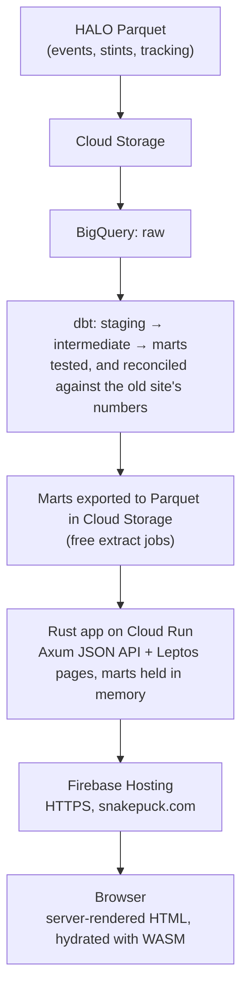

# SnakePuck

Analytics on AHL player tracking data (HALO): team standings, player stats, game
reports with rink playback of each shift, and defensemen loose-puck-recovery analysis.

**Live: https://snakepuck.com**

The site was rebuilt in 2026, from a Python Dash app on Postgres into a BigQuery and dbt
pipeline feeding a single Rust app. The migration went phase by phase, with the old
site serving throughout, and its plan and decisions are in
[`docs/MIGRATION_PLAN.md`](docs/MIGRATION_PLAN.md).

## Architecture



- **Data:** raw HALO files load into BigQuery (`infra/load_raw.sh`). dbt models them into
  marts: player, team and game stats in five situations, shifts and stints with on-ice
  expected goals, per-event tracking snapshots, and the LPR analysis (`dbt/`).
- **Serving:** the marts are exported to Parquet (`infra/export_serving.py`). The Rust
  app loads the small ones into typed structs and indexes at startup, and loads a game's
  events, shifts and tracking on demand, with a small cache.
- **Pages:** Leptos renders every page on the server, then hydrates it in the browser.
  A page's state (season, sort, situation, the shift on the rink) lives in its URL, so
  any view can be linked to. Each page makes one API request, typed by the same Rust
  structs on both sides. The rink is SVG drawn by Leptos.
- **Hosting:** a single Cloud Run service that scales to zero, behind Firebase Hosting.
  It runs in N. Virginia, near the East Coast visitors, while the warehouse and data stay
  in Iowa: the app reads the marts at startup, and each game's files the first time it's
  opened. It costs about $0–2 a month at blog traffic; the old site cost about $42.

## Performance

Measured against the old Dash site serving the same pages
([`docs/BENCHMARKS.md`](docs/BENCHMARKS.md)):

- **Same machine, same data:** each page's data comes back 36–209× faster, and the rink
  for one shift 179× faster. Throughput is 74–509× higher, on about a tenth of the memory.
- **Live, as a visitor sees it:** 1.3–7× faster per page, and 40× for the rink. Network
  round trips make up most of a page load, so the gap narrows.

## Repo layout

```
site/          Rust crate: Axum API (src/server) + Leptos pages (src/app), Dockerfile,
               Cloud Run service, browser smoke tests (e2e/)
dbt/           dbt project: staging, intermediate and mart models, tests
infra/         GCP setup and runbooks (README.md), raw load, serving export, Firebase config
content/blog/  blog posts, Markdown with front matter, built into the image
bench/         the Dash vs Rust benchmark (Dash side: git tag dash-final)
docs/          the migration plan and the benchmark results
```

## Running it

The HALO data is licensed, so it's never in this repo, in CI or in the container image.
The Rust tests build their data in memory; everything else needs a copy of the serving
export in `site/data/serving`.

```bash
cd site
cargo leptos watch                  # the site at http://localhost:3000
cargo test --features ssr           # API and data tests (synthetic data)
cd .. && pytest                     # browser smoke tests on every page (needs the data)
```

`pytest` builds and serves the site on port 3010, then drives Chrome through each page:
it checks that the page hydrates, that its controls work, and that there are no console
errors. CI checks formatting, lints the server and browser builds and runs the Rust tests,
then deploys to Cloud Run on `main` (`.github/workflows/site.yml`). dbt changes build in a
CI dataset before prod (`dbt.yml`).
